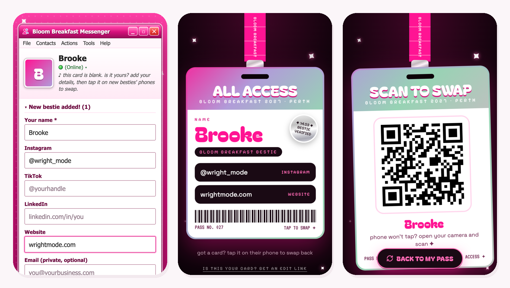

# Event Tap Cards

Tap-to-share cards for your event. Every guest gets a blank NFC card. They tap it on their phone, add their name and socials, and from then on, tapping their card on anyone else's phone shows a backstage pass with their links. No app, no business cards, no "how do you spell your handle?".

## How it works

Each card holds one web address, like `your-site.netlify.app/c/27-k3x9qm`. That's it: the card is just a link. This website decides what to show:

- **A blank card** opens a "make it yours" window (in the style of an early-2000s messenger). The first person to save it owns it.
- **A set-up card** shows that person's backstage pass: name, Instagram, TikTok, LinkedIn, website.
- **The owner's own phone** gets an edit button, and the pass flips over to a big QR code for phones that won't tap.

The number in the address tells you where you're up to when you write the cards. The six letters after it are a secret code made from your own secret key, so nobody can browse other people's cards by changing the number.

## What you get

- **The card page** every card opens: set-up window, backstage pass, edit, clear, flip to QR
- **A type-first page** (`/cards`) for your big-screen QR: people fill in their details while you explain, then one tap and they're done
- **A big-screen page** (`/screen`) with the QR and the 4 steps, for a TV or projector
- **An admin page:** who's set up a card, hide or reset any card, and the card lists to write your cards from
- **Optional email edit links:** owners add a private email and get a link to edit their card later from any phone
- Your event name, colours and fonts, all from one settings file

## What you need

- A computer with **Claude Code** (or Codex)
- A free **Netlify** account, to put it online. The free plan allows business use
- **Blank NFC cards** (NTAG215 is a good pick: rewritable, plenty of room). One per guest, plus spares
- An **iPhone** with the **NFC Tools** app (by wakdev) and its **Pro** upgrade, to write the cards. Its Import from CSV, which writes a whole batch, needs Pro (A$5.99 one-off in Australia)
- Optional: a free **Resend** account and your own domain, for the email edit links

## Set it up (the easy way)

1. Download this folder and open it in Claude Code (or Codex).
2. Say: **"Set up my tap cards"**. Claude asks for your event name, date, city and colours, and does the rest.
3. Try it on your laptop. Claude gives you a links file: open a test card link and set it up like a guest would.
4. Say: **"Put it live"**. Claude walks you through Netlify and gives you the live links.
5. Say: **"Make my card lists"**, then write the cards on your iPhone ([the guide](docs/WRITE-THE-CARDS.md)).

⚠ **Put it live before you write any cards.** Each card holds the live address forever. Want your own domain? Set it up first. Once cards are written, the address and your secret key must never change.

## The guides

| Guide | What's in it |
|---|---|
| [Write the cards](docs/WRITE-THE-CARDS.md) | Which cards to buy, NFC Tools, writing them in batches, and what to do when the app loses your place |
| [Customise it](docs/CUSTOMISE.md) | Every setting in plain English: words, colours, fonts, which links the form asks for |
| [Go live](docs/GO-LIVE.md) | Netlify step by step, turning on email edit links, and what the free plans allow |
| [On the day](docs/ON-THE-DAY.md) | Running the card set-up moment, what to say, tapping tips, and after the event |
| [Build your own](prompts/build-your-own.md) | A prompt to have Claude build something like this around your own tools instead |

## What it costs

- **Netlify free plan:** 300 credits a month. Each time you put a new version live uses 15, so test on your computer first and go live once or twice. Card taps for a normal event use a small slice. If the credits run out, Netlify pauses the site until next month, so don't redeploy 20 times the week of your event.
- **NFC Tools Pro:** one-off, to write cards in batches.
- **The cards:** shop around. Rewritable NTAG215 cards come in packs of 10 or more.
- **Resend free plan (optional email):** up to 100 emails a day.

## Your guests' privacy

- Anyone who taps a card sees that person's name and links. The set-up window says so, and asks people to only add what they'd hand a stranger.
- The private email (if you turn on edit links) never shows on a pass. Only you see it, on the admin page.
- Card pages are kept out of Google, and the secret code stops anyone flicking through card numbers.
- Someone wants their details gone? **Reset** their card on the admin page. Owners can also clear their own card any time.

## What's in the folder

| Where | What it is |
|---|---|
| `public/cards.config.json` | **all your settings**: event name, words on the pass, colours, fonts |
| `public/*.html`, `public/js/`, `public/css/` | the card page, set-up page, big-screen page and admin page |
| `netlify/functions/` | the small server bits: loading a card, saving it, edit links, the admin page |
| `tools/` | `new-keys.sh` (your secret keys), `links.sh` (your private links), `card-list.mjs` (card lists), `check.mjs` (checks your setup) |
| `docs/` | the guides |

## Licence

MIT: use it, change it, run it for your clients. Fonts load from Google Fonts. The QR code maker is qrcode-generator by Kazuhiko Arase (MIT). The messenger look is our own drawing in the spirit of early-2000s chat apps, not anyone's logo.
